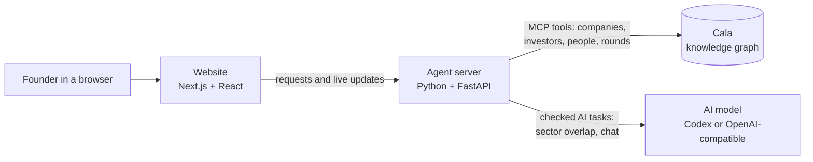

# RoundCloser

**An AI agent that helps startup founders fill the rest of a funding round.** You give
it your lead investor. In about two minutes it returns up to five other investors likely
to join, explains why each one fits, shows how you can reach them, and writes the
introduction request for you.

Built for the Cala AI hackathon (November 2026). Cala is a knowledge-graph data
service that holds facts about companies, investors, people and funding rounds.

> **In one line:** an AI-native product, built AI-natively. An agent reasons over a
> live knowledge graph, AI handles the language and checked code makes the decisions.
> The whole thing was built spec-first with AI coding agents.

---

## The problem

When a startup raises money, one investor usually "leads" the round and commits
first. That typically covers 50–80% of the target. The founder then has to find other
investors for the remaining share, and the best way in is a warm introduction.

Founders usually do this by hand: they read news articles, scroll investor databases
and guess who knows whom. It is slow and unreliable, and the founder has nothing
concrete to show the lead when asking for introductions.

## What RoundCloser does

| Step | The founder… | The agent… |
|---|---|---|
| 1. Identify | Types the company name and the lead investor's name | Finds both in Cala and shows the matching records |
| 2. Confirm | Picks the right company and investor | Pre-fills known details (website, country, sector) with their sources |
| 3. Describe the round | Enters stage, target and money already committed | Works out how much is still open |
| 4. Watch | Sees every step live | Explores the knowledge graph, profiles candidates, finds warm paths and scores each investor |
| 5. Act | Copies an introduction request, explores the network graph or asks the AI assistant | Gives reasons, sources, a next step and a suggested split of the open amount |

---

## What is new about it

### 1. It treats fundraising as a network problem, not a search problem

Most investor tools give you a filtered list: "seed-stage fintech investors in Europe".
RoundCloser asks a different question: **who has actually invested alongside your lead,
in the same funding round?** Those investors already know and trust your lead, so an
introduction from the lead is far more likely to work. RoundCloser follows the
relationships in Cala's knowledge graph to find them.

### 2. It looks in three networks at once

| Network | Who it finds | Why it matters |
|---|---|---|
| Your lead's network | Investors who joined the lead in the same rounds during the last five years | The lead can introduce you personally |
| Your cap table | Investors who already backed your company | The easiest yes: they already believe in you |
| Your founders' history | Investors who backed companies your founders started before | They know the team's track record |

### 3. It finds warm paths through people, called "trust loops"

The agent builds a map of people and organisations from public professional records,
such as former colleagues, board seats, schools and funds. It then looks for short
paths from you to the investor, for example: *you → your former colleague → partner
at the target fund*. A path that also runs back through your lead counts as stronger.

The method borrows from network science, the study of how connections form:

- A path is only as strong as its weakest link.
- A contact who knows everyone counts for less than a contact with a close, specific link.
- Older connections count for less over time.
- Many weak paths cannot add up to look like one strong path.

Each path is marked "unconfirmed" until the founder ticks "I know this person".

### 4. The scoring is explainable

Each investor is checked against **12 plain yes/no rules**: 7 about connection, 1 about
activity, 3 about fit and 1 about risk. A score reads as "8 of 12 rules met", and every
"yes" links to its source. When data is missing, the rule shows as **"not checked"**,
never as a silent "no". Founders and judges can see exactly why an investor ranks where
it does.

### 5. It goes from insight to action in one screen

The output is ready to use. Each investor comes with a **recommended next step**:
contact them directly, go through a named mutual contact, ask your lead, or skip. It
also comes with a **copyable introduction request** and a **suggested split** of the
open amount. An **interactive network graph** and an **AI assistant** let the founder
explore and question the result.

---

## AI-native engineering

### In the product: an agent with guardrails

- **The agent works through MCP.** Model Context Protocol is the standard way AI agents
  connect to outside tools and data. RoundCloser discovers Cala's tools automatically
  and checks every request against the tool's own published format before sending it.
- **AI and code each do the job they are best at.** The AI model reads evidence to judge
  sector overlap, answers questions in the chat and helps with wording. Deterministic
  code makes every decision that matters: identities, scores, rankings and exclusions.
  This keeps results repeatable and auditable.
- **Every AI output is checked.** The model may cite only the sources it was given. It
  cannot add or remove investors, and any judgement it makes must point to evidence.
  If a check fails, or the model is slow or unavailable, the app falls back to plain
  rules and templates instead of showing an unchecked answer.
- **Grounded chat.** The assistant answers only from the saved result of the current
  search. Its citations must link to real sources, and it cannot invent new investors.
- **Bounded, observable autonomy.** The agent works within a 120-second, 72-request
  budget and runs up to six lookups in parallel. Every tool call, cached answer and
  retry streams live to the screen. If the agent runs out of budget, it returns what it
  has and says what is missing.
- **No lock-in to one AI provider.** It runs on a local Codex login or any
  OpenAI-compatible model, such as DeepSeek, chosen by one setting.

### In how it was built: spec-first, agent-assisted

- **Written specification first.** A product requirements document
  ([PRD](<Co-Investor Finder — MVP PRD.md>)) defined the user, the rules and the
  limits before any code was written. It served as the brief for both the human team
  and the AI coding agents.
- **Built with AI coding agents.** Development used AI pair-programmers such as Claude
  Code, and commits made with AI help are marked with co-author credits. The repo gives
  agents their own instructions (`frontend/AGENTS.md`). The team also packaged
  reusable agent skills for the visual style, the knowledge-graph view and quick public
  deployment.
- **Evidence before features.** The backend had to pass a
  [readiness check](docs/backend-readiness.md) (67 automated tests plus ten live runs
  against real Cala data) before frontend work began. A read-only
  [audit of Cala's API](docs/cala-connection-audit.md) shaped the trust-loop and
  founder-network features.
- **Parallel work, documented merges.** Separate branches developed the core
  logic and the interface in parallel. They were merged with a
  [written record](docs/branch-basic-integration.md) of which version of each feature
  was kept.
- **Automated quality checks.** Around 200 backend tests and browser-based frontend
  tests run on every change through GitHub Actions.

---

## How it is built



| Part | Technology | What it does |
|---|---|---|
| Website (frontend) | Next.js 16, React 19, TypeScript | Forms, live agent progress, results, interactive network graph, chat |
| Agent server (backend) | Python 3.11, FastAPI, asyncio | Runs the search, applies the rules, builds trust loops, writes requests |
| Knowledge source | Cala MCP and REST APIs | Verified facts about companies, investors, people and funding rounds |
| AI model | Codex CLI or any OpenAI-compatible model | Sector-overlap judgements and the results chat, always checked |
| Quality | pytest, Playwright, GitHub Actions | Automated tests on every change |

Other engineering details:
- **Live progress:** updates reach the browser as they happen and resume after a
  dropped connection.
- **Cache:** data is cached for an hour, so repeat searches are fast and cheap.
- **Keys stay server-side:** API keys never reach the browser.

The full technical design and step-by-step agent flow are in
**[Architecture and orchestration](docs/architecture.md)**.

---

## Running it locally (for developers)

You need Python 3.11+, Node.js 20.9+ and a Cala API key.

```powershell
# 1. Backend
cd backend
python -m venv .venv
.venv/Scripts/python -m pip install -r requirements-dev.txt
Copy-Item .env.example .env        # then put your CALA_API_KEY in .env
.venv/Scripts/python -m uvicorn app.main:app --host 127.0.0.1 --port 8000

# 2. Frontend (second terminal)
cd frontend
npm ci
npm run dev
```

Open <http://localhost:3000>. API docs are at <http://127.0.0.1:8000/docs>.
On macOS/Linux, use `.venv/bin/python` instead of `.venv/Scripts/python`.

More detail: [backend](backend/README.md) · [frontend](frontend/README.md) ·
[HTTP API](docs/api.md) · [implementation status](docs/implementation-status.md)

## Limitations

- RoundCloser shows that investors have worked with your lead before. It cannot tell
  whether they will invest this time.
- A warm path means two people had public roles at the same organisation at the same
  time. It does not prove they know each other, which is why the founder confirms
  the paths they know.
- Suggested investment amounts are estimates from past rounds. Where there is no
  estimate, that share stays unallocated.
- Results are kept in memory for an hour and there are no user accounts.
