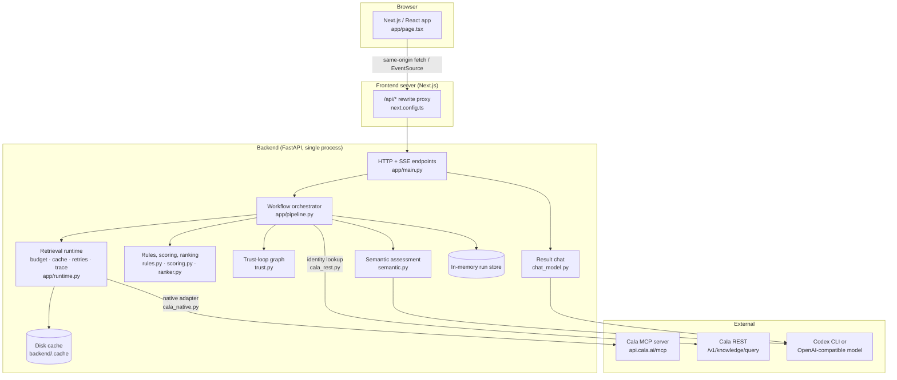
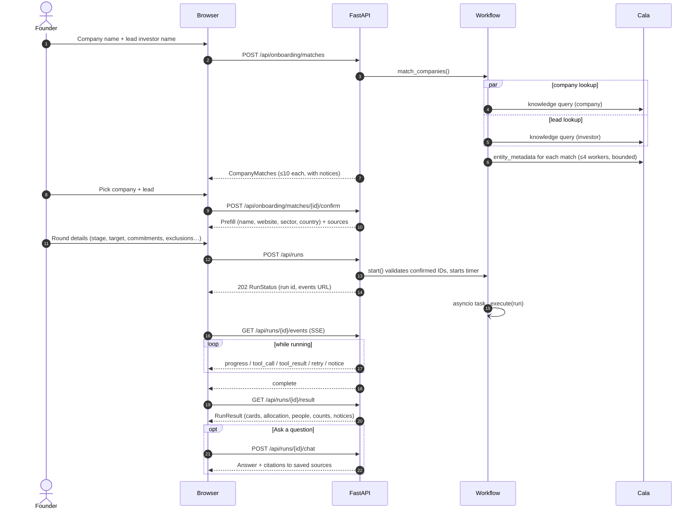

# Architecture and orchestration

This document explains how RoundMe is put together, how one agent run is
orchestrated from start to finish, and which engineering choices are new. The [README](../README.md) has the plain-language overview. The
[HTTP API](api.md) lists every request and response field.

## Highlights

RoundMe is an agentic system with a strict division of labour. The **agent** decides
what to retrieve, within a hard budget. **Deterministic code** makes every decision.
The **language model** does only language and judgement tasks whose output can be
checked. The innovation is in what the agent looks for: relationships in a knowledge
graph that make an introduction likely, not investor profiles that merely match a filter.

### Innovation

| Idea | What is new | How it is implemented | Where |
|---|---|---|---|
| Same-round co-investment | Candidates must have joined the **same identified funding event** as the lead. Investing in the same company in a different round does not count. This targets investors with a proven working relationship with the lead, not lookalikes | Lead graph traversal over funding-event IDs, deduplicated by event identity and restricted to dated, sourced rounds in the lookback window | `cala_native.lead_graph`, `pipeline._qualified_rounds` |
| Three-network discovery | Searches the lead's network, the startup's own cap table and the founders' previous companies **in one bounded run** | Wave 0 and Wave 1 lookups merged into one candidate pool, with `origins` provenance per investor | `pipeline._execute`, `_add_origin`, `_preliminary` |
| Trust loops | Warm introduction paths are **scored, explained and confirmable**, not just listed | People-and-institutions graph built from sourced, dated roles. Paths of at most two edges from home to the fund unit, closed through the lead. Weakest-link strength, Adamic–Adar contact discount, recency decay, saturating aggregation | `trust.build_graph`, `trust.measure` |
| Known-unknown scoring | Every rule is met, not met or **not checked**. A missing lookup is never scored as a negative | `RuleContext` records which lookups ran. 12 binary rules, score = rules met | `rules.py` |
| Rules drive the action | The same rules that rank an investor also choose the **next step** (direct, via contact, ask the lead, skip) and the request template | Fixed action ladder over rule outcomes | `ranker.recommended_action`, `scoring._draft` |
| Capital plan | Converts the shortlist into a **suggested split** of the open amount, with every estimate labelled and the unestimated remainder left open | Greedy fill from historical ticket proxies, exact decimal arithmetic | `scoring.build_allocation` |
| Explorable evidence | The result is an **interactive knowledge graph**: people are squares, organisations are circles, rounds sit on edges, and node size grows with the number of connections | `react-force-graph-2d` with custom physics and paint layers | `frontend/lib/result-graph.ts`, `graph-physics.ts`, `force-graph-paint.ts` |

### AI-native engineering patterns

| Pattern | Implementation | Where |
|---|---|---|
| **MCP-native tool use** | The agent discovers Cala's MCP tools at runtime. It checks the input format each tool publishes for itself is a valid JSON Schema, then validates every argument against it before calling. A tool missing from discovery is an explicit error, never a guess | `cala_native.call_data_tool` |
| **Budgeted autonomy** | One `Retrieval` choke point enforces the deadline, call budget, concurrency limit and retry policy for every underlying tool call, including the hidden calls inside multi-step joins | `runtime.Retrieval` |
| **Graceful degradation** | Optional lookups turn into "unknown" instead of failing the run. Running out of budget returns a `partial` result with what is missing listed. A model failure falls back to deterministic templates | `pipeline._optional`, `_execute` |
| **Decisions in code, language in the model** | The model never sets identities, scores, rankings or exclusions. It labels sector and portfolio overlap from supplied facts, and it powers chat | `semantic.py`, `chat_model.py` |
| **Constrained generation, two layers** | The required answer format (JSON Schema) restricts citation IDs and investor IDs to the saved run's catalogue. The server then validates the output again: citations, investor IDs and every URL in the message text must come from the saved sources | `chat_model._output_schema`, `LiveResultChat.reply`, `semantic._apply` |
| **Evidence-gated judgement** | A semantic assessment other than "unknown" must cite sources it was given. Any change to the candidate set rejects the whole assessment | `semantic._apply`, `pipeline._execute` |
| **Sandboxed model runtime** | The Codex CLI runs ephemeral and read-only in a temporary directory, ignoring user config. Shell, browser, plugins, multi-agent and web search are disabled. `CALA_*` credentials (and, for chat, `MODEL_*` settings) are removed from its environment | `semantic.CodexSemantic`, `chat_model.CodexChatTransport` |
| **Prompt-injection hygiene** | Retrieved facts and chat history are passed as role-labelled JSON data under a fixed system message, not as instructions. Answer size is capped | `chat_model.build_messages` |
| **Model-agnostic transports** | Codex CLI, or any OpenAI-compatible `/chat/completions` endpoint with JSON-schema output, selected by `MODEL_PROVIDER`. Both fall back to JSON-object mode when a provider rejects JSON-schema output (e.g. DeepSeek) | `semantic.py`, `chat_model.py`, `config.py` |
| **Observable agent** | Every tool call, cache hit, retry and notice is a numbered progress event, streamed over SSE and replayable from `Last-Event-ID` | `runtime.Trace`, `main.run_events` |
| **Cost-aware memory** | Disk cache keyed by a hash of endpoint, credentials and mapping, plus operation and arguments. Writes are atomic, and identical in-flight calls are deduplicated | `runtime.ResponseCache`, `Retrieval.call` |

## 1. System overview

| Layer | Responsibility | Key files |
|---|---|---|
| Browser UI | Five-phase flow (`identify → matches → details → running → results`), live progress, result workspace, force-directed knowledge graph, chat | `frontend/app/page.tsx`, `frontend/components/*`, `frontend/lib/*` |
| Frontend server | Proxies `/api/*` to the backend so the browser never needs the backend URL or any credential. Proxy timeout raised to 60 s for slow Cala knowledge queries | `frontend/next.config.ts` |
| API layer | Validation, uniform error envelope `{error: {code, message, details}}`, CORS, SSE streaming, client-disconnect handling for chat | `backend/app/main.py` |
| Orchestrator | Identity resolution, onboarding confirmation, and the run itself, executed in waves | `backend/app/pipeline.py` |
| Retrieval runtime | Single choke point for every Cala call: deadline, call budget, concurrency semaphore, 1-hour disk cache, in-flight deduplication, one retry for transient failures, progress events | `backend/app/runtime.py` |
| Cala adapters | **Native MCP** (default): discovers tool schemas, validates arguments against them, joins investors through exact funding-event IDs. **Mapped MCP**: an optional reviewed JSON mapping. **REST**: onboarding name lookups | `cala_native.py`, `cala.py`, `cala_rest.py`, `entity_metadata.py` |
| Decision logic | 12-rule checklist, ranking, recommended action, exclusions, ticket estimates, greedy allocation, introduction-request templates | `rules.py`, `scoring.py`, `ranker.py`, `main_scoring.py` |
| Trust graph | People-and-institutions graph built from sourced roles and funding events. Measures short "trust loops" from founder to investor | `trust.py` |
| Model layer | Optional. Labels sector and portfolio overlap from retrieved facts only, and answers chat questions about a finished run. It cannot change scores, identities or exclusions | `semantic.py`, `chat_model.py` |

### Deployment shape

- **Backend:** one Uvicorn worker (`backend/Dockerfile`). Runs, resolutions and
  onboarding matches live in process memory and expire after `RETENTION_SECONDS`
  (default 1 h). Capacity is capped by `MAX_ACTIVE_RUNS` (8) and `MAX_STORED_RUNS` (200).
  Because state is in memory, it must stay single-worker.
- **Frontend:** a standard Next.js server pointed at the backend through `BACKEND_API_URL`.
- **Secrets:** `CALA_API_KEY` and any model key exist only in `backend/.env`. When the
  Codex CLI is used, Cala credentials are excluded from its subprocess environment.
- **CI:** GitHub Actions runs `pytest` for backend changes and `typecheck`, the
  graph Playwright specs and `next build` for frontend changes.

## 2. Request lifecycle

Identity safeguards:

- A run can start only with IDs that this server actually offered and the founder
  confirmed. If the company or lead name changes after confirmation, the run is refused
  (`confirmed_startup_changed`, `confirmed_lead_changed`).
- Lead auto-detection, used by the older `/api/resolve` path, picks a company only on an
  exact name, alias or website match, never on the first fuzzy result.
- If the open allocation is zero, no Cala search is made.

## 3. Run orchestration

`Workflow._execute` runs in the background as an `asyncio` task. Every Cala access goes
through one `Retrieval` object, so the whole run shares a single budget.

### Budgets and guards

| Guard | Default | Effect |
|---|---|---|
| Run deadline | 120 s (`RUN_DEADLINE_SECONDS`) | Hard wall-clock limit from confirmation |
| Assembly reserve | 10 s | Retrieval stops at 110 s so scoring and drafting always finish |
| Call budget | 72 calls (`CALA_CALL_LIMIT`) | Counts every real MCP tool call, including the calls inside multi-step joins |
| Concurrency | 6 (`CALA_CONCURRENCY`) | Global semaphore. Waiting for it counts against the deadline |
| Per-call timeout | 15 s (40 s for REST knowledge query) | Each call is also capped by the remaining run time |
| Retries | 1 | Only for timeouts or transient Cala errors, honouring `retry_after` |
| Cache | 1 h TTL on disk | Keyed by SHA-256 of (endpoint + credentials + mapping, operation, args). Writes are atomic |
| In-flight dedup | per run | Identical concurrent tool calls share one response |

When a budget runs out, the run raises `BudgetExceeded`. The orchestrator catches it
and returns state `partial` with everything gathered so far. Optional lookups use
`_optional()`: if one fails, its signal becomes "unknown" and the run carries on.

### Waves

```mermaid
flowchart TD
    S([Founder confirms → timer starts]) --> W0

    subgraph W0["Wave 0 — parallel discovery"]
        direction LR
        A1["lead_graph<br/>lead's funding rounds<br/>(≤6 rounds, 60-month lookback)"]
        A2["entity_people<br/>startup's founders"]
        A3["search_entities<br/>lead partner (person)"]
        A4["company_rounds<br/>startup's own rounds"]
    end

    W0 --> P1["Build candidate pool<br/>Source 1: co-investors in sourced, dated rounds with the lead<br/>Source 2: existing investors from the startup's rounds<br/>Apply founder exclusions → preliminary list (≤15)"]

    P1 --> W1

    subgraph W1["Wave 1 — runs concurrently"]
        direction LR
        B1["Profile batch<br/>investor_profile × up to 8<br/>(2 slots reserved for founder network)"]
        B2["Trust people task<br/>person_roles for founders + lead partner<br/>→ entity_people for ≤4 orgs<br/>→ company_rounds for ≤2 previous companies"]
    end

    W1 --> P2["Source 3: backers of founders' previous companies<br/>→ profile remaining slots"]
    P2 --> SEM["Semantic assessment (optional)<br/>model labels sector/overlap from retrieved facts<br/>≤20 s, discarded if it changes the candidate set"]
    SEM --> CTX["Company context<br/>entity_metadata for ≤6 most-shared portfolio companies<br/>(industry + headquarters)"]
    CTX --> SC["Score every profile against 12 rules"]
    SC --> TG["Build trust graph → measure loops per candidate"]
    TG --> FIN["Finalize: trust rules, recommended action, draft request<br/>Rank → top 5 → allocation + combined request"]
    FIN --> R([RunResult · state = completed / partial / no_match / failed])
```

Ordering decisions:

- **Preliminary ranking** of candidates before profiling: existing investors first, then
  investors who are both lead co-investors and previous-company backers, then other lead
  co-investors, then the rest. Ties are broken by number of distinct shared companies,
  recency, stage match and name.
- **Profiling stops early on failure.** If one profile in a batch fails, that investor
  is kept as "incomplete", not rejected, and the run does not spend the rest of its
  budget on replacements.
- **The trust-people lookups start in parallel with the first profiling batch**, because
  they are independent and each costs up to two calls.

### Progress events

`Trace.emit` adds a numbered `ProgressEvent` and wakes any SSE listeners. The
`/events` endpoint:

- replays from `Last-Event-ID`, so a reconnecting browser misses nothing;
- sends a keepalive comment every 10 s;
- closes once the result exists or the client disconnects.

The frontend maps the event `step` names onto four visible stages
(`frontend/lib/run-progress.ts`), and the bar never moves backwards:

| UI stage | Backend steps |
|---|---|
| Discover & profile investors | `confirmation`, `lead_graph`, `founder_network`, `profiles`, `trust` |
| Review portfolio evidence | `assessments`, `company_context` |
| Score fit & connections | `scoring`, `loops` |
| Prepare shortlist & requests | `finalizing` |

## 4. Decision logic

### Rules (`rules.py`)

Each rule returns **met** (1 point), **not met** (0) or **not checked** (0 points,
labelled as such). `RuleContext` records which lookups actually happened, so a missing
lookup is never counted as a negative answer.

| Group | Rule | Met when |
|---|---|---|
| Connection | Lead co-investor | ≥1 shared round with the lead |
| Connection | Repeat partner | Shared rounds with the lead in ≥2 companies |
| Connection | Recent partner | Shared round with the lead in the last 24 months |
| Connection | Your investor | Invested in one of the startup's own rounds |
| Connection | Backed your founder | Backed a company a founder previously founded |
| Connection | Warm path | ≥1 trust loop |
| Connection | Lead-closed path | A trust loop that also runs through the lead |
| Activity | Recently active | An investment in the last 12 months |
| Fit | Stage match | ≥25% of rounds with a known stage are at the founder's stage |
| Fit | Sector match | Backed a portfolio company in the founder's sector |
| Fit | Country match | Backed a company headquartered in the founder's country (HQ only. Office or registration addresses are not used) |
| Risk | No competitor | Has not backed a named competitor |

**Ranking** (`ranker.py`): rules met, then Connection rules met, then most recent sourced
evidence, then name and ID, giving a stable order. Scoring version `rules-2026-11`.

**Recommended action**: existing investor → *reach out directly*; warm path → *reach out
via contact* (named person); lead co-investor → *ask lead for an intro*; otherwise *skip*.

### Trust loops (`trust.py`)

The trust graph is a single graph of people and institutions. Its edges come only from
sourced, dated public facts:

- **Professional roles:** worked together, board seats, same school, founder of a company.
- **Funding facts:** person at a fund, invested in the startup, invested in a founder's
  previous company, co-invested with the lead, lead led the startup.

Each edge type has a fixed weight. Edges between two people are scaled by how long their
dates overlap and by how small the organisation is. Older facts count less, with a
four-year half-life.

The search looks for paths from **home** (the startup plus its founders) to the
**candidate unit** (the fund plus its current people). A path has at most two edges:
a direct link, or a link through one common contact. If the fund has co-invested with
the lead, the path closes back home through the lead, so a loop has at most four edges.

- A path is only as strong as its weakest edge.
- A contact who is connected to many people counts for less, using an Adamic–Adar
  discount.
- Bonuses apply when a loop runs through the lead, starts at the lead partner, or has
  been confirmed by the founder ("I know this person").
- Contributions are summed per contact and squashed into a 0–1 score
  (`1 − e^(−Σ)`), so many weak loops cannot add up to an inflated score.
- Up to three loops are kept per investor. Each is labelled unconfirmed until the
  founder confirms it, because sharing an employer does not prove acquaintance.

### Allocation (`scoring.build_allocation`)

The shortlisted investors are taken in rank order. Each gets the smaller of its
estimated ticket and the amount still open. Ticket estimates come from historical EUR
round totals divided by the observed number of investors. Any amount left over is shown
as "Still open". Percentages are rounded, and the rounding remainder is added to the
largest share so the total is exactly 100%.

### Model boundaries

- **Semantic assessment:** the model receives the founder profile and the retrieved Cala
  facts. Its output is accepted only if every assessment refers to a known investor and
  company pair and cites only source URLs it was given. Any "known" label must have a
  source, and the candidate set must not change. If it fails, sector overlap stays "unknown" and the deterministic
  templates are used.
- **Chat:** each question gets a bounded snapshot of the saved result, with the top five
  cards, rules, loops and sources, plus recent history. The answer format limits
  `source_ids` and `candidate_ids` to that snapshot. The server rejects any answer
  with an unknown citation, an unknown investor, or a URL that is not a saved source
  (or the startup's website). Chat cannot start new discovery or change the result.
  Concurrency is capped (`CHAT_MAX_CONCURRENCY`, default 2), and generation is
  cancelled when the browser disconnects.
- **Codex isolation:** both semantic assessment and chat run the Codex CLI as an
  ephemeral, read-only subprocess with external tools disabled. Cala credentials are
  removed from its environment, and prompts go through stdin, never command-line
  arguments.
- Both work with the local Codex CLI or any `/chat/completions` endpoint that supports
  JSON-schema output. Both fall back to JSON-object mode for providers without
  structured output, such as DeepSeek.

## 5. Frontend structure

| Area | Files | Notes |
|---|---|---|
| Flow and forms | `app/page.tsx` | Phase state machine, exact EUR parsing with K/M shorthand, investor status rows |
| API client | `lib/api.ts`, `lib/chat-api.ts` | Same-origin `fetch`, typed `ApiError`, `EventSource` with deduplication by event ID |
| Results workspace | `components/results-workspace.tsx`, `score-explainer.tsx`, `allocation-panel.tsx`, `agent-insights.tsx`, `results-chat.tsx` | Cards, rule checklist, action ladder, copy buttons, allocation, trace and chat |
| Knowledge graph | `components/results-graph.tsx`, `force-graph-*.tsx`, `lib/result-graph.ts`, `lib/force-graph-*.ts`, `lib/graph-physics.ts` | `react-force-graph-2d`. Organisations are circles and people are squares. Funding rounds sit on edges. Node size grows with the number of connections. Labels appear on zoom |
| Types | `lib/types.ts` | Mirrors the backend Pydantic models in `backend/app/models.py` |

The frontend does not make decisions. Eligibility, scores, rankings, considerations
and request text all come from the backend.

## 6. Failure states

| State | When |
|---|---|
| `completed` | All discovery finished and at least one candidate qualified |
| `partial` | A budget ran out, the graph was not confirmed complete, some profiles failed, or Cala failed after the lead graph arrived |
| `no_match` | Discovery finished but no eligible, fully profiled candidate was found. The list is never padded with generic investors |
| `no_open_allocation` | Commitments already meet the target. No search is made |
| `failed` | Cala failed before any graph data arrived, or an internal error occurred (logged server-side, never shown to the user) |

## 7. Testing

- **Backend:** about 200 `pytest` tests in 21 files. They cover adapters (native, mapped
  and REST), budgets, caching, the onboarding flow, rules and scoring, trust loops,
  metadata merging, chat and end-to-end workflows, against fixtures and fake providers.
  `scripts/acceptance_live.py` and `scripts/acceptance_semantic.py` run against the
  real services.
- **Frontend:** Playwright specs for graph data and physics, result graph, progress
  stages, score explainer, metadata display and the full workflow.

## 8. How it was built: AI-native development

The project was built in one hackathon day by a small team working with AI coding
agents. The process was designed so that agents could move fast without drifting from
the product's rules.

| Practice | What it looked like |
|---|---|
| **The spec is the brief** | The [MVP PRD](<../Co-Investor Finder — MVP PRD.md>) fixed the user, the design principles ("say unknown, never guess", "trust Cala"), the agent steps, the budgets and the acceptance criteria before implementation began. It was updated when decisions changed, for example dropping the shared-round requirement on 14 November 2026 |
| **AI pair-programming with attribution** | Implementation used AI coding agents such as Claude Code. Commits made with agent help carry `Co-Authored-By` trailers |
| **Agent context in the repo** | `frontend/AGENTS.md` tells agents that this Next.js version differs from their training data and points them to the bundled docs. Local reusable agent skills captured the visual style, the force-directed knowledge-graph pattern and quick public deployment |
| **Backend first, behind an evidence gate** | The frontend started only after the backend passed a [readiness gate](backend-readiness.md): 67 automated tests plus ten founder-confirmed runs against live Cala data |
| **Measure the data source before building on it** | A read-only [connection audit](cala-connection-audit.md) of the live Cala MCP endpoint (23 data-tool calls) showed which founder, employment, board and funding edges exist. It recommended founder-network paths as a separate expansion, which became founder-network discovery and trust loops. Further phases are tracked in the [connection improvement plan](connection-improvement-plan.md) |
| **Parallel branches, explicit provenance** | `main` (scoring, allocation, chat) and `branch-one` (UI, knowledge graph) developed in parallel. They were merged into `branch-basic`, and the [integration notes](branch-basic-integration.md) record which version of each feature was kept and why |
| **Tests as the agents' guardrail** | Policy modules are covered by deterministic fixtures, including a frozen scoring fixture from an earlier commit (`tests/fixtures/main-scoring-1fed306.json`). CI runs on every push, so agent-made changes cannot silently alter the rules |
| **Live acceptance scripts** | `scripts/acceptance_live.py` and `scripts/acceptance_semantic.py` exercise the real Cala and model integrations separately from the offline suite |
