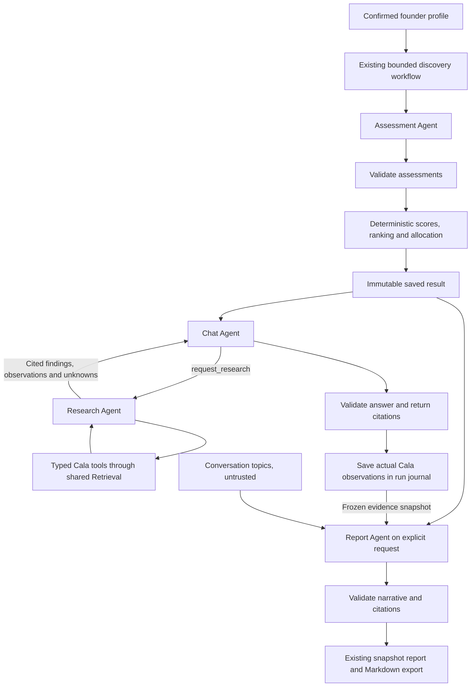

# Multi-agent workflow

`branch-multiagents` separates model instructions, context, tools and output contracts
by role. It uses the existing Python/asyncio runtime and model API transport, without
LangChain, extra model downloads or separate agent servers.

## Implemented flow



Discovery policy stays in `pipeline.py`: confirmed identities, candidate origins,
eligibility, ranking and allocation are not delegated to a model. The new Research
Agent handles adaptive follow-up evidence requests during chat, rather than replacing
mandatory discovery with unconstrained model decisions.

## Roles and handoffs

| Role | Interface and context | Model-owned decisions | Output and permissions |
| --- | --- | --- | --- |
| Research | `ResearchAgent.run(ResearchRequest, AgentToolSession, context)`; focused question, known entities, source catalogue and bounded observations | Which approved Cala lookup to perform next and when enough evidence exists | `ResearchResult`: cited findings, unknowns and coverage. Read-only Cala tools; no scoring, final user answer or publishing. |
| Assessment | `AssessmentAgent.assess(founder, profiles)`; founder context and retrieved portfolio facts | Sector fit, product overlap and evidence sufficiency | Existing validated assessments for supplied investor/company pairs and source URLs; at most one validation repair. No discovery tools or numeric scoring. |
| Chat | `ChatAgent.reply(result, request, on_step)`; saved result, selected investor and recent conversation | Answer from existing evidence or delegate a focused research task | Existing `ChatResponse` with validated citations and shortlist IDs. Only `request_research` and `final_answer` tools in multi-agent mode. |
| Report | `ReportAgent.reply(result, ReportRequest, research=snapshot)`; saved-result evidence, server-recorded Cala observations and topic-only conversation history | Narrative emphasis, suggested next steps and report wording | Validated `ChatResponse` narrative and citations. At most one repair; no discovery tools, score changes or external publication. |

Research and chat have separate model/tool loops and message histories. A shared
model API can serve both roles. Assessment and reporting are constrained specialist
generation roles, not additional autonomous discovery loops.

The tool executor registers facts and sources from actual validated Cala responses.
Generated research findings do not become entity records or new sources. The chat
handoff includes both the validated research summary and server-recorded observations.
Missing or failed research remains unknown; observations already registered can still
support an answer if the research summary fails. Oversized observations are compacted
as valid JSON and explicitly marked partial/truncated.

After a chat answer validates, its actual sourced tool observations are merged into
that run's separate research journal. Generated chat/research prose never becomes
evidence. Local source IDs are remapped across requests; identical refetches do not
advance the revision. Failed or cancelled answers commit nothing. The legacy direct
tool loop uses the same journal. Saved shortlist, scores and allocation stay unchanged.

The journal retains at most 32 observations and 60 KB, keeping the newest observations
when older ones must be evicted and marking coverage partial. It lives in memory with
the run and expires with it; it does not survive a backend restart. Each report captures
one isolated snapshot and remaps its references into the report's source catalogue.
Additional chat findings arriving during generation do not change that report's revision.

## Controls

- A chat request owns one `Retrieval` instance, evidence catalogue, tool-step list and
  model-call budget. Research delegations cannot create fresh Cala allowances.
- Native graph joins still charge every underlying Cala call through `Retrieval`.
- Chat and research share `CHAT_TIMEOUT_SECONDS` (90 by default), with 30 seconds
  reserved for the final chat answer. Research never uses the answer reserve.
- `CHAT_CALA_CALL_LIMIT` defaults to 24. `AGENT_MODEL_CALL_LIMIT` defaults to 12 across
  both roles and reserves one final chat call. Provider compatibility retries are
  handled by the transport; rejected requests are not independent agent turns.
- Research defaults to three tool rounds and at most five model calls per delegation,
  with at most four Cala tools per turn. The outer chat caps delegations, repeated
  requests and total activity records. These limits also apply to cache-heavy runs.
- Each report has its own 45-second timeout and bounded concurrency; report generation
  is a separate user request and does not reuse a finished chat request's budget.
- Browser disconnects cancel active generation. Output-validation retries remain
  inside the original deadline. Agent roles are attributed on chat activity events.
- `validate_answer` and assessment validation verify schemas, source/identity
  membership and permitted URLs. They do not prove claim entailment or factual
  accuracy; real-model evaluation must assess those separately.
- In-memory runs, existing retention and single-worker deployment requirements remain.

## Configuration

Select an API with OpenAI-compatible `/chat/completions`, tool calling and JSON output:

```dotenv
MODEL_PROVIDER=openai_compatible
MODEL_BASE_URL=https://your-provider.example/v1
MODEL_API_KEY=<private model API key>
MODEL_NAME=<provider model name>
CALA_API_KEY=<private Cala key>
MULTI_AGENTS_ENABLED=true
CHAT_AGENT_ENABLED=true
RESEARCH_MAX_TOOL_ROUNDS=3
RESEARCH_MAX_MODEL_CALLS=5
AGENT_MODEL_CALL_LIMIT=12
REPORT_TIMEOUT_SECONDS=45
```

Use private `backend/.env` or deployment environment variables. Keep credentials off
the frontend and out of version control. JSON-schema output falls back to JSON-object
mode when the provider rejects it; all results still pass server validation. Tool
choice compatibility is handled separately; provider/model behavior needs live tests.

`MULTI_AGENTS_ENABLED=false` selects the legacy direct-tool chat and original semantic
transport. `CHAT_AGENT_ENABLED=false` or unconfigured Cala selects saved-result chat.
Codex CLI remains saved-result chat because its tools are disabled; the delegated
research/chat loop requires `MODEL_PROVIDER=openai_compatible`. Report generation can
use either configured transport. `MODEL_PROVIDER=disabled` leaves reports unavailable,
and the frontend explicitly falls back to its deterministic snapshot.

## HTTP and frontend

- Existing JSON and SSE chat routes retain their contracts. `ChatToolStep.agent` is
  optional (`chat`, `research`, `assessment`, `report`); older clients can ignore it.
- `ChatResponse.evidence_revision` is an additive integer: chat returns the available
  journal revision, while report returns the exact revision captured for that generation.
- `GET /api/runs/{run_id}/evidence` returns `revision`, `observation_count`, `updated_at`
  and `truncated`. It is a read-only freshness check with no model or Cala calls.
- `POST /api/runs/{run_id}/report`, body `{"history": [{"role": "user", "content": "..."}]}`,
  returns the existing `ChatResponse` shape. History is optional, limited to eight
  messages with at most 4,000 characters each, and supplies topics only.
- Unknown/not-ready runs return 404/409. Disabled, busy, invalid and timed-out report
  generation returns explicit errors. No external report publishing endpoint is added.
- The first Generate report request creates a report; successful reports are retained
  within the current results workspace. Higher evidence revisions show "New findings
  available" and an explicit "Update report" action. Plain chat does not trigger model
  regeneration. Reopening a completed report reuses it. Updates keep the old report and
  export intact until a new generation succeeds. Closing or changing runs aborts pending
  work; stale responses cannot change another run. Cited sources remain clickable in the
  application and Markdown export.

## Verification

Offline tests use scripted models and fake Cala responses: independent agent contexts,
typed handoffs, citation rejection, immutable results, underlying-call accounting,
shared model/deadline limits, retries and cancellation. Assessment and report tests
exercise role-specific prompts, schema compatibility, evidence validation and HTTP
contracts. Frontend tests cover role-attributed activity, report generation, citation
links, export, retry/fallback and stale requests. These checks do not establish live
provider latency, real-model grounding accuracy or current Cala availability.
